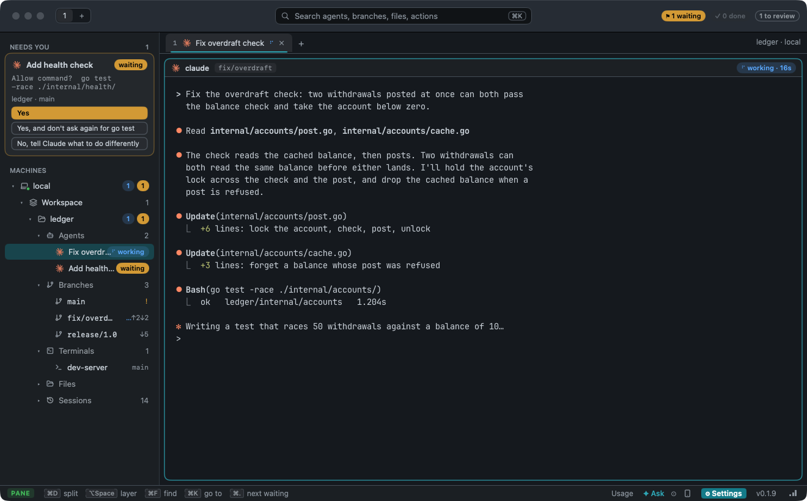
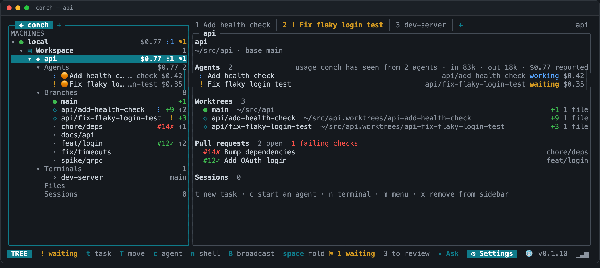
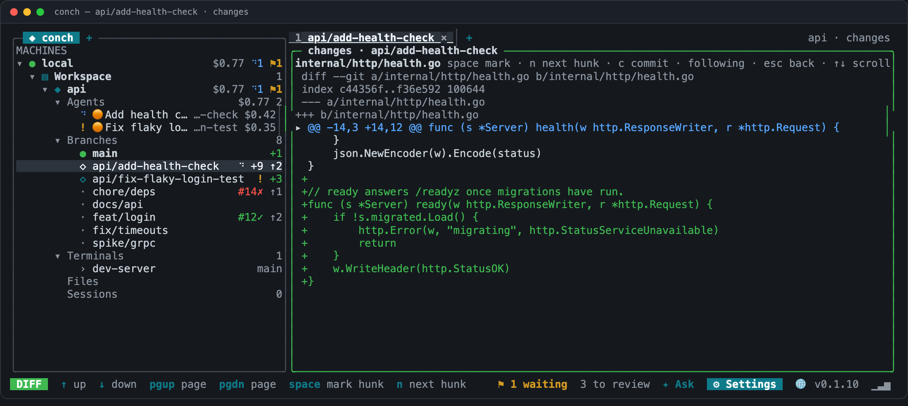
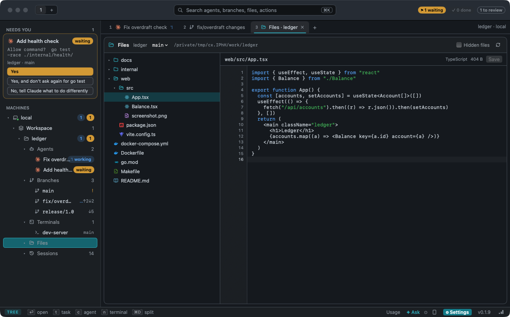
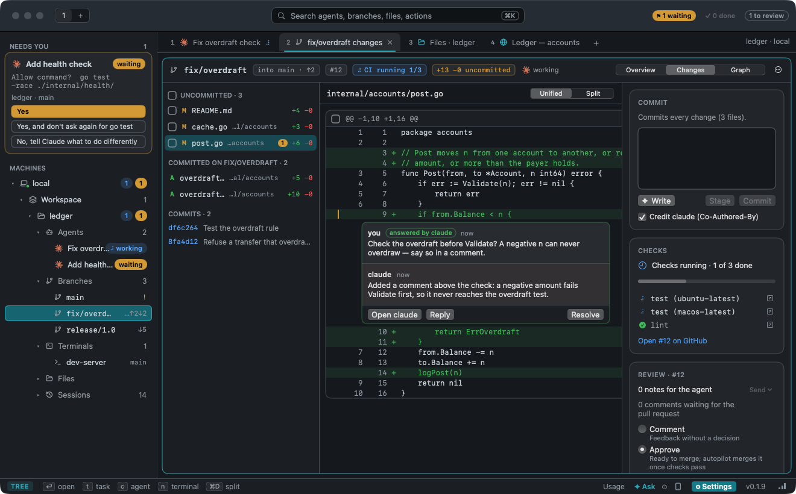
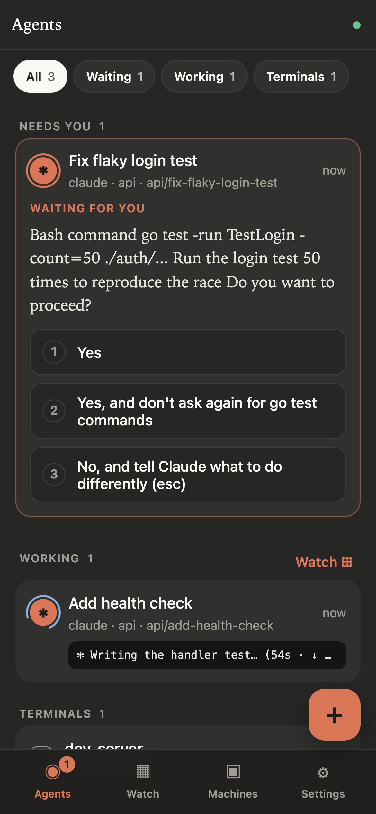

<h1 align="center">
  <a href="https://amitgb14.github.io/conch/"></a> conch
</h1>

<p align="center">
  <a href="https://github.com/Amitgb14/conch"></a>
  <a href="https://github.com/Amitgb14/conch/releases/latest"></a>
  <a href="https://github.com/Amitgb14/conch/actions/workflows/ci.yml"></a>
  <a href="LICENSE"></a>
  
</p>

<p align="center">
  <strong>A terminal orchestrator for AI coding agents.</strong><br/>
  Run Claude Code, Codex, Gemini CLI and a dozen more side by side, each on its own branch and worktree, on your laptop or on machines over SSH.
  A background server owns their terminals, so they keep working when you close the UI — and the same agents are a native Mac window or your phone away.
</p>

<h3 align="center"><a href="#install"><ins>Install conch</ins></a> · <a href="https://amitgb14.github.io/conch/docs/"><ins>Documentation</ins></a></h3>

<p align="center">
  
</p>

## Features

<table>
<tr>
<td width="50%" valign="middle">

### A tree of everything

Machines → projects → branches, agents and terminals, beside a live view of
whatever you select. Tabs and splits behave like tmux windows; `!` jumps to
the next agent waiting on you.

[Docs →](https://amitgb14.github.io/conch/docs/interface)

</td>
<td width="50%"></td>
</tr>
<tr>
<td width="50%" valign="middle">

### Review before it lands

A branch's uncommitted files and commits ahead, each diff hunk by hunk;
`space` stages one, and a note on a line goes to the agent, which answers it
in the thread.

[Docs →](https://amitgb14.github.io/conch/docs/tasks)

</td>
<td width="50%"></td>
</tr>
<tr>
<td width="50%" valign="middle">

### Conch.app, on a Mac <sup>beta</sup>

The same agents in a native window, panes drawn by
[Ghostty](https://ghostty.org). A waiting agent's question comes with its
answers to click; ⌘K finds a pane, a branch or a file, and ⌘S saves one —
checked against what the agents wrote meanwhile.

[Docs →](https://amitgb14.github.io/conch/docs/mac-app)

</td>
<td width="50%"></td>
</tr>
<tr>
<td width="50%" valign="middle">

### Changes, files and the dev server, in tabs

In Conch.app a branch's changes, the project's files and the dev server's page
sit in tabs beside the agents: stage a hunk, write the commit, watch the pull
request's checks, submit a review.

[Docs →](https://amitgb14.github.io/conch/docs/mac-app)

</td>
<td width="50%"></td>
</tr>
<tr>
<td width="50%" valign="middle">

### From your phone

`conch web` serves the same agents to a phone: what each is doing, the
question it is waiting on with its answers as buttons, and a keyboard into
any terminal. Nothing to install; off your tailnet it goes through a relay
you run yourself, end-to-end encrypted.

[Docs →](https://amitgb14.github.io/conch/docs/phone)

</td>
<td width="50%" align="center"></td>
</tr>
</table>

**Also in the box:**

- **[Remote machines](https://amitgb14.github.io/conch/docs/remote-machines)** — `conch machine add` installs conch over SSH; `conch project move` takes branches, worktrees and agents there.
- **[Cloud sandboxes](https://amitgb14.github.io/conch/docs/sandboxes)** — providers described by a file, from a signed registry; `conch-sandbox` makes them for [herdr and Orca](https://amitgb14.github.io/conch/docs/sandbox-tools) too.
- **[Sessions](https://amitgb14.github.io/conch/docs/sessions)** — every agent's saved conversations per project, to resume or delete.
- **[The brain](https://amitgb14.github.io/conch/docs/brain)** — ask in plain words with `:`; nothing it proposes runs until you press Enter.
- **[Agents working together](https://amitgb14.github.io/conch/docs/agents-together)** — skills that let an agent start helpers, review until clean and take a ticket to a merged pull request.
- **[Autopilot](https://amitgb14.github.io/conch/docs/agents-together)** — a failed CI run sent back to the branch's agent, a green pull request merged, issues triaged and queued as tasks.
- **[Mobile preview](https://amitgb14.github.io/conch/docs/mobile-preview)** — iOS simulators and Android emulators an agent can look at with `conch preview shot`.
- **[MCP and the CLI](https://amitgb14.github.io/conch/docs/cli)** — `conch new/send/read`, and `conch mcp` for agents that speak MCP.
- **Hot reload** — the server moves onto a new build without stopping your agents.

## Supported agents

<p>
<kbd>Claude Code</kbd>&nbsp;
<kbd>Codex</kbd>&nbsp;
<kbd>Gemini CLI</kbd>&nbsp;
<kbd>OpenCode</kbd>&nbsp;
<kbd>Devin</kbd>&nbsp;
<kbd>Copilot CLI</kbd>&nbsp;
<kbd>Cline</kbd>&nbsp;
<kbd>Qwen Code</kbd>&nbsp;
<kbd>Goose</kbd>
</p>

Sessions, setup, skills and state for each. conch also runs and watches:

<p>
<kbd>Aider</kbd>&nbsp;
<kbd>Amp</kbd>&nbsp;
<kbd>Antigravity CLI</kbd>&nbsp;
<kbd>Auggie</kbd>&nbsp;
<kbd>Continue CLI</kbd>&nbsp;
<kbd>Crush</kbd>&nbsp;
<kbd>Cursor CLI</kbd>&nbsp;
<kbd>Droid</kbd>&nbsp;
<kbd>Grok</kbd>&nbsp;
<kbd>Kilo Code</kbd>&nbsp;
<kbd>Kimi Code</kbd>&nbsp;
<kbd>Kiro CLI</kbd>&nbsp;
<kbd>Mistral Vibe</kbd>&nbsp;
<kbd>Pi</kbd>&nbsp;
<kbd>+ any CLI agent</kbd>
</p>

Add your own with `conch agent add`. See [Agents](https://amitgb14.github.io/conch/docs/agents).

## Install

### CLI and TUI — macOS, Linux (amd64, arm64)

```sh
curl -fsSL https://raw.githubusercontent.com/Amitgb14/conch/master/install.sh | sh
```

_Or with a package manager:_

```sh
# Homebrew, macOS or Linux
brew install Amitgb14/conch/conch

# Go 1.25+
go install github.com/Amitgb14/conch/cmd/conch@latest
```

`conch update` upgrades to the newest release (`update list`, `update
rollback`); a Homebrew install is updated with `brew upgrade conch`, and conch
then offers to reload onto it. On Windows, use WSL.

### Conch.app — macOS (beta)

- [Download the latest release](https://github.com/Amitgb14/conch/releases/latest), or build it from [`macos/`](macos).

### Phone

- Run `conch web`, then `conch web pair` and scan the QR code. See [Phone](https://amitgb14.github.io/conch/docs/phone).

## Quick start

```sh
conch                                   # open the TUI (starts the server)
conch task -cwd ~/src/api "Add a health check endpoint"   # branch + worktree + agent
conch machine add gpu-box               # add a remote machine over ssh
conch project move api -to gpu-box      # branches, worktrees and agents, moved there
conch status                            # panes with agent state
conch read gpu-box:p3                   # a pane's screen, by the ID every view shows
conch agent skill -apply                # teach your agents to drive conch
```

In the TUI: `t` new task · `c` start an agent · `:` ask in plain words ·
`B` broadcast to a group · `!` next agent waiting for you · `?` all keys ·
`q` detach.

The skills are also a Claude Code plugin:
`/plugin marketplace add Amitgb14/conch` then `/plugin install conch@conch`.

## Is it for you?

It is for running **several** agents at once and keeping track of them — which
one is waiting on you, what each has changed, and getting back to them after
your laptop slept. It earns its keep from the third agent, not the first.

It is the wrong shape if you run one agent in one repo, if you branch and
commit by hand, or if review means a conversation with other people (pair it
with `gh` for that). And it waits for Enter on purpose, so it is not the tool
for unattended swarms. [The longer version](https://amitgb14.github.io/conch/docs/#is-conch-for-you),
losses included.

## Community & support

- **Bugs and ideas:** [GitHub issues](https://github.com/Amitgb14/conch/issues) — `conch bug` fills in versions and counts, never your paths or screens.
- **Health check:** `conch doctor` says what is wrong and how to fix it.
- **Show support:** star [the repository](https://github.com/Amitgb14/conch).

## Developing

```sh
make build        # bin/conch
make test         # go test -race -timeout 20m ./...
make lint         # gofmt, go vet, staticcheck — CI's lint job
make gate         # lint, then the suite with internal/server in shards — what CI runs
```

[AGENTS.md](AGENTS.md) has the rules for contributing, including keeping tests
away from your own running conch. The settings page
(`internal/configweb/app`) is committed as built: after changing it, run
`make settings-ui` (needs pnpm) and commit `internal/configweb/dist`. The
website lives in [`web/`](web); its screenshots are regenerated by
`web/scripts/tui-capture` and `web/scripts/phone-capture`.

<p align="center">
  <a href="https://star-history.com/#Amitgb14/conch&Date"></a>
</p>

## License

conch is free and open source under the [Apache License 2.0](LICENSE).
