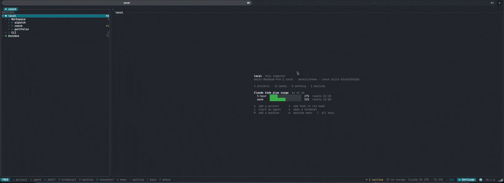
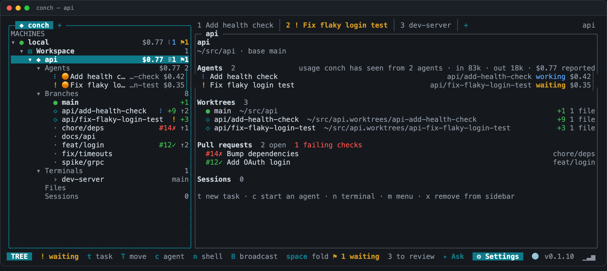
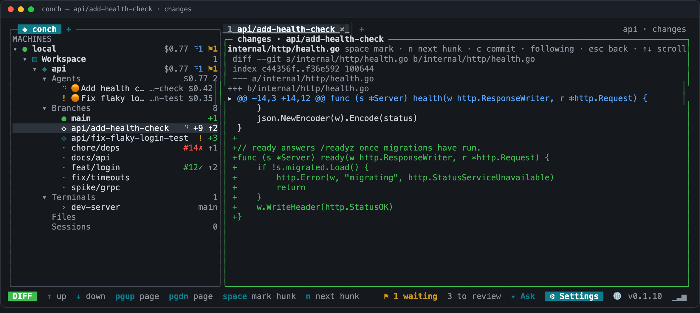
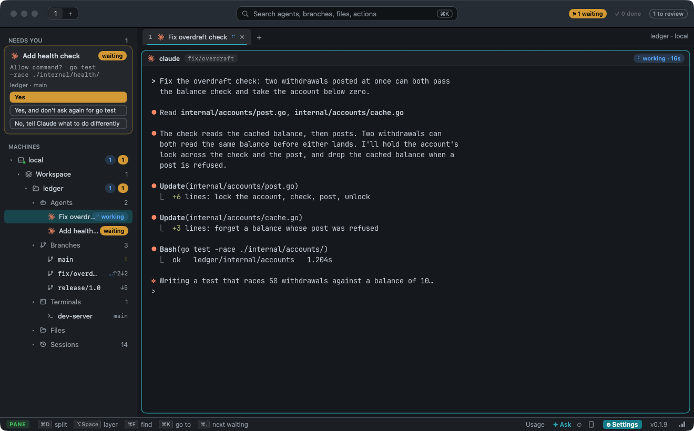
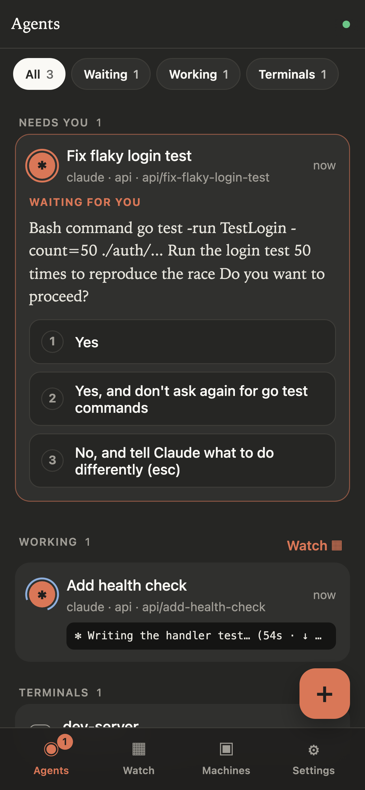

# conch

A terminal orchestrator for AI coding agents. A background server owns the
terminals your agents run in, so they keep working when you close the UI. The
TUI organises everything as a tree — machines, projects, git branches, agents
and terminals — beside a live view of whatever you select. It is not the only
way in: [Conch.app](#conchapp-on-a-mac) is the same thing in a native Mac
window, and [`conch web`](#from-your-phone) hands it to your phone.

Works with **Claude Code**, **Codex**, **Gemini CLI**, **OpenCode** and
**Devin**, on your machine or on remote machines over SSH.

**[Website](https://amitgb14.github.io/conch/) · [Documentation](https://amitgb14.github.io/conch/docs/)**

## Is it for you?

It is for running **several** agents at once and keeping track of them — which
one is waiting on you, what each has changed, and getting back to them after
your laptop slept. It earns its keep from the third agent, not the first.

It is the wrong shape if you run one agent in one repo (use the agent's own
CLI, with tmux if you want it to survive a dropped ssh session), if you branch
and commit by hand (a plain multiplexer gives you panes without the opinions),
or if review means comments, threads and approvals — conch reads diffs side by
side and stages hunks, but has no review threads and no approving a pull
request, so pair it with `gh` or your forge for those. It is macOS and Linux; on Windows, WSL. And
it waits for Enter on purpose: nothing the brain proposes runs until you
confirm, so it is not the tool for unattended swarms.

[The longer version](https://amitgb14.github.io/conch/docs/#is-conch-for-you),
losses included.



Adding a project: pick a folder, and its branches, agents and terminals are
there to open.



A project expanded into branches, agents and terminals, with a tab per agent
— and beside it what the project holds: each worktree, the open pull requests
and their checks, and what the agents have spent.



Review an agent's work before it lands: a branch's uncommitted files and
commits ahead, each diff hunk by hunk, and `space` to stage one.

## Install

macOS and Linux (amd64 and arm64):

```sh
curl -fsSL https://raw.githubusercontent.com/Amitgb14/conch/master/install.sh | sh
```

With Homebrew, on macOS or Linux:

```sh
brew install Amitgb14/conch/conch
```

Or with Go 1.25+: `go install github.com/Amitgb14/conch/cmd/conch@latest`.
`conch update` upgrades to the newest release, `conch update list` shows
what is published and `conch update rollback` goes back to the version
before it; `conch server reload` moves the server onto a new build without
stopping your agents. A Homebrew install is updated with `brew upgrade conch`
instead, and conch then offers to reload onto it.

## Quick start

```sh
conch                                   # open the TUI (starts the server)
conch task -cwd ~/src/api "Add a health check endpoint"   # branch + worktree + agent
conch machine add gpu-box               # add a remote machine over ssh
conch project move api -to gpu-box      # branches, worktrees and agents, moved there
conch status                            # panes with agent state
conch read gpu-box:p3                   # a pane's screen, by the ID every view shows
```

In the TUI: `t` new task · `c` start an agent · `:` ask in plain words ·
`B` broadcast to a group · `!` jump to the next agent waiting for you · `?` all keys ·
`q` detach.

## Conch.app, on a Mac

Conch.app is conch in a native macOS window — another client of the same
servers, so it shows the agents the TUI shows and closing it stops none of
them. Panes are drawn by [Ghostty](https://ghostty.org); a branch's changes,
its files and the dev server's page sit in tabs beside the agents; ⌘K finds a
pane, a branch or a file. It is in **beta**:
[download it](https://github.com/Amitgb14/conch/releases/latest) or build it
from [`macos/`](macos).



[What the window holds](https://amitgb14.github.io/conch/docs/mac-app), key
by key.

## From your phone

`conch web` serves the same agents to a phone: what each one is doing, the
question it is waiting on with its answers as buttons, every screen at once,
and a keyboard into any terminal. It is a page the gateway serves itself —
nothing to install, and no service of conch's in between.

```sh
conch web          # the gateway, in front of the same server
conch web pair     # a QR code and a one-time code for the phone
```



On your own tailnet the phone reaches the laptop directly. From any other
network it goes through a **relay** you run yourself (`conch relay`): the
phone and the laptop both connect out to it, and what it carries it cannot
read — they make a [Noise](https://noiseprotocol.org) session whose key
travels in the QR code, through the camera rather than the network. See
[Phone](https://amitgb14.github.io/conch/docs/phone).

## Skills for your agents

conch carries skills that teach an agent to run other agents: start a
helper and read its answer (`conch`), several at once (`conch-team`),
review until clean (`conch-review`), tests to a merged pull request
(`conch-ship`), a ticket all the way (`conch-factory`), and the automated
workflow for a project (`conch-autopilot`). Install them for every agent
— Claude Code, Codex, Gemini CLI, OpenCode and Devin:

```sh
conch agent skill -apply
```

Or, in Claude Code, as a plugin from this repository:

```
/plugin marketplace add Amitgb14/conch
/plugin install conch@conch
```

Then ask an agent in a conch pane: *"take issue 123 to a merged pull
request"*, *"set up an automated workflow for this project"*. They act
only inside conch. See [Agents working together](https://amitgb14.github.io/conch/docs/agents-together).

## Development

```sh
make build        # bin/conch
make test         # go test -race -timeout 20m ./...
make lint         # gofmt, go vet, staticcheck — what CI checks first
```

The tests of the phone app and the settings page run with node and skip
without it. The settings page (`internal/configweb/app`) is committed as
built; after changing it, run `make settings-ui` (needs pnpm) and commit
`internal/configweb/dist`. [AGENTS.md](AGENTS.md) has the rules for
contributing, including keeping tests away from your own running conch.

The website and documentation live in [`web/`](web), a Next.js and
shadcn/ui app (`pnpm dev` there). Its screenshots are regenerated rather
than taken by hand: `web/scripts/tui-capture/capture.sh` stages a demo
project in a scratch conch and saves the TUI's screens,
`web/scripts/phone-capture/capture.sh` photographs the phone app in
headless Chrome, and both keep away from your own server and agents.

## License

Apache License 2.0 — see [LICENSE](LICENSE).
