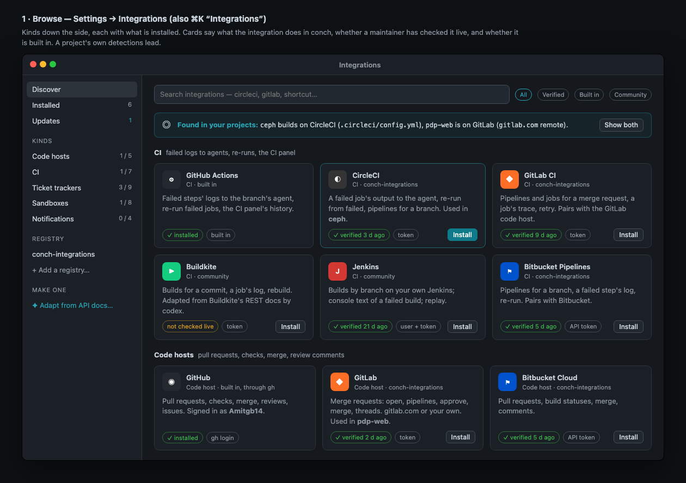
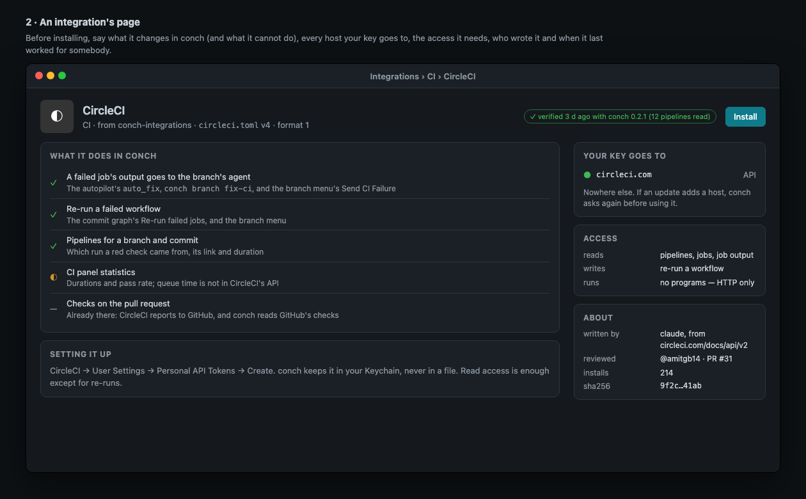
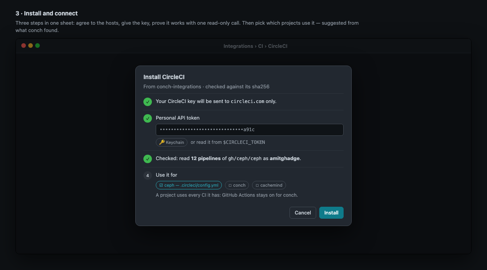
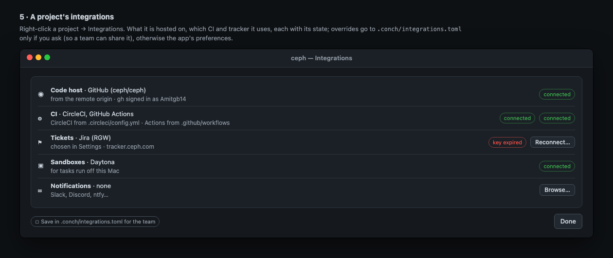
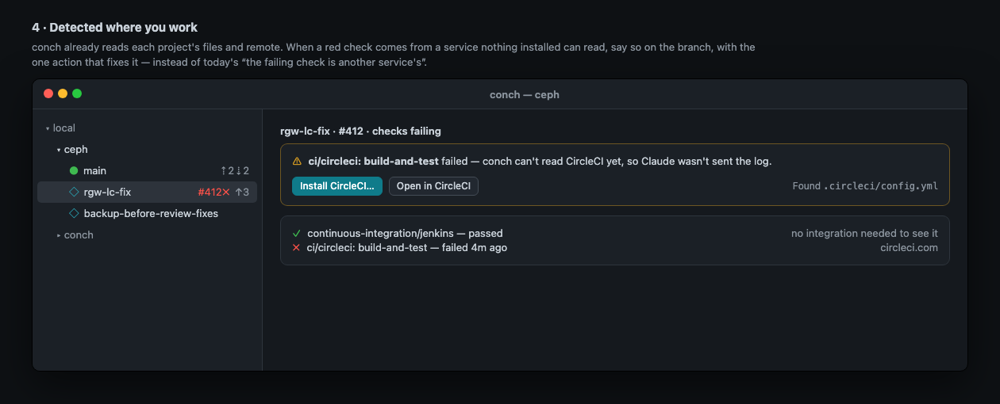
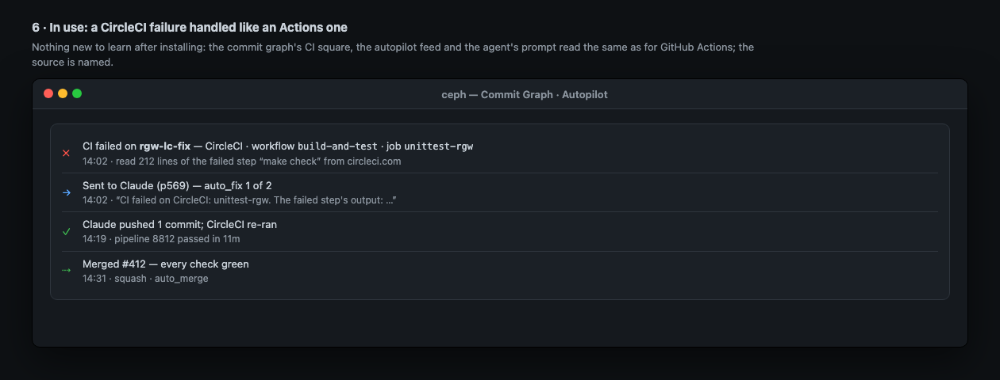
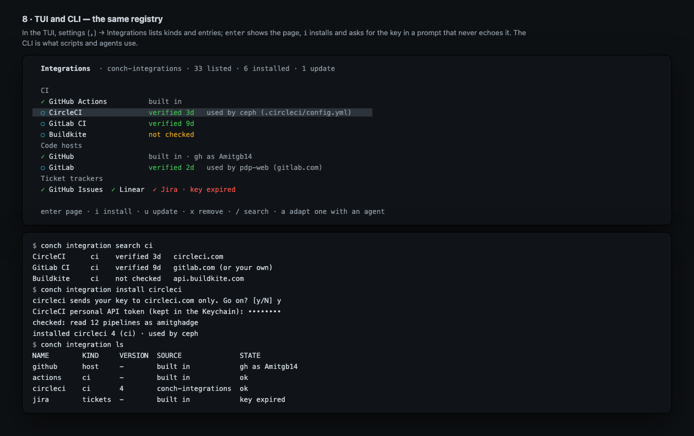
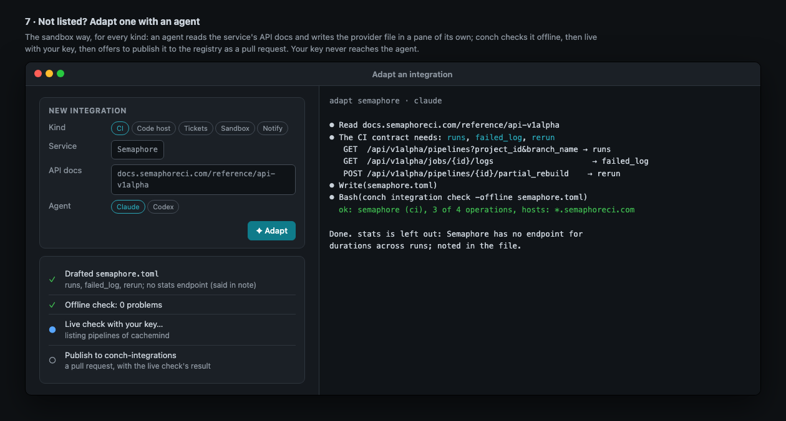
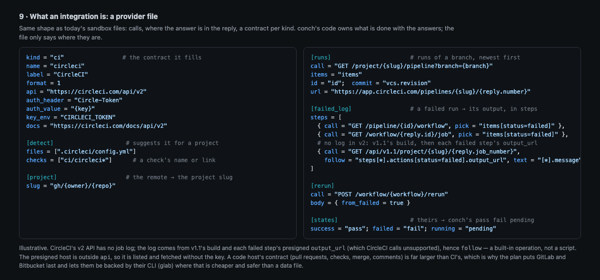

# Integrations — tasks for agents

Read this whole file before starting any task. It is self-contained: every
screen of the mocks is described here in words, and pictured in
`docs/plans/marketplace-mocks/mN.png` (open them; they are the design).
Background and reasons: [marketplace.md](marketplace.md). Sources for every
API fact: [marketplace-research.md](marketplace-research.md). The mocks as
one page: [marketplace-mocks.html](marketplace-mocks.html) (open in a
browser; `?only=m3` shows one).

## Rules for every task

- Follow `AGENTS.md` (repository root) to the letter: tests with every
  change (normal use and edge cases), test isolation (never the person's
  real `~/.config/conch`, keys, network or agents — `httptest` servers for
  every provider API), `make gate` green before any push, docs in the same
  change, a capability string for every new method or field
  (`internal/proto`, `omitempty` fields), older servers and clients keep
  working.
- Work test-first, one slice at a time; commit small commits that say what
  and why.
- **Never put a key in a file conch writes, a log, a test fixture or an
  agent's prompt.** Keys come from the Keychain (service `conch-mcp`,
  account = the variable's name, see `internal/server/secrets.go` and
  `internal/config/trackers.go`) or an environment variable.
- **A provider file never runs a program.** Every request goes to the
  file's `api` (or the person's `base_url`) with the key, or to a declared
  `follow` host without it. A request to any other host is refused, in
  code, with a test.
- The words in the UI are the mocks' words. Where a mock and this file
  disagree, this file wins; say so in the pull request.
- Each task ends with: what was tested, what wasn't, and a row in
  `docs/testing/end-to-end.md` for anything that needs a real service
  (take the next free 9.x number on master).
- Out of scope for every task: paid listings, ratings, code plugins, any
  integration that changes conch's UI.

## Status

Updated as tasks land. This file replaces `integrations-tasks.md` (an
earlier split of phase 1 into four tasks, A–D: A is in T1, B in T3, C in
T5, D in the docs each task writes).

| Task | Status | What is there |
| --- | --- | --- |
| T1 format + engine | **in progress** | `internal/integration`: a `ci` file's keys, `Problems()` (every problem, not the first), remote parsing; the format guide `format.md`. Not yet: running steps, format 3 shared with sandbox files, `[auth]`, `base_url`, `[states]`, `runs`/`rerun` |
| T2 registry v2 | not started | |
| T3 CI kind | not started | |
| T4 CI files | **started** | `files/circleci.toml`, `files/gitlab-ci.toml` shipped inside conch until T2's registry exists, `failed_log` only, checked offline by a test; not run against a server yet |
| T5 CLI | not started | |
| T6 detection | **started** | `[detect] files` and `remotes`, `File.Uses`, `For(kind, root, remote)`; not `checks`, not the server method, not `.conch/integrations.toml` |
| T7–T13 | not started | |

## Order

```
T1 format+engine ─┬─ T2 registry v2 ─┬─ T5 CLI ──────────┬─ T7 Conch.app window (m1 m2 m3)
                  │                  │                   ├─ T8 project sheet (m5)
                  ├─ T3 CI kind ─────┼─ T4 CI files ─────┼─ T9 failing-check card (m4) + feed (m6)
                  │                  │                   ├─ T10 TUI (m8)
                  │                  └─ T6 detection ────┘
                  └─ T11 adapt + publish (m7)        T12 tickets/notify files    T13 code hosts (plan only)
```

T1 → T2 → T3 → T4 is the critical path (CircleCI working end to end).
T7–T10 can run in parallel once T2, T3, T5 and T6 are merged.

---

## T1 — Provider file format v3: kinds and operations (engine)

**Depends on:** nothing. **Size:** L.

**Goal.** Grow today's sandbox provider file (`internal/sandbox/custom.go`,
format in `internal/sandbox/providerfile.md`) into a general one with a
`kind`, without breaking any sandbox file in use.

**What to build.**
- Move the HTTP-and-TOML engine out of `internal/sandbox` into a new
  package `internal/integration` (calls, placeholders, dotted reply paths,
  format 2 selectors, auth header/value, key from env/Keychain, host
  checks). `internal/sandbox` keeps working on top of it, unchanged in
  behaviour (its tests must pass untouched).
- New keys, in a file that says `format = 3`:
  - `kind` = `sandbox` (default for older files) | `ci` | `tickets` |
    `notify` | `host`.
  - `[auth]` with `type` = `header` (default: `auth_header`/`auth_value`
    as today) | `bearer` (+ `scopes = [...]`, shown to the person) |
    `basic` (user + token: two values asked for).
  - `base_url = "ask"` for self-hosted services (Jenkins, GitLab
    self-managed): the person gives it at install; it joins the host list.
  - Operation tables (`[runs]`, `[failed_log]`, …) whose names come from
    the kind's contract (T3 defines `ci`). Each is either one `call` or
    `steps = [...]`: a chain where each step may `pick` an item
    (`items[status=failed]`) whose fields the next step reads as
    `{reply.x}`.
  - `follow = "path.to[*].urls"`: fetch each URL found there **without**
    the key; their hosts must be listed in `follow_hosts = [...]` or the
    file is refused.
  - `text = "."` (the reply is the text) or `text = "[*].message"` (join
    a JSON array's fields).
  - `[detect]` (`files`, `remotes`, `checks`) and `[project]` (`slug`
    template from `{owner}` `{repo}` `{host}` of the project's remote) —
    parsed here, used by T6.
  - `[states]` mapping the provider's words to the kind's.
- `Check(file)`: offline validation that names every problem (unknown
  key, unknown operation for the kind, a required operation missing, a
  `{placeholder}` nothing fills, `follow` host not listed, a non-https
  `api`, `{key}` anywhere but auth).
- A conch too old for format 3 must refuse such a file (it already
  refuses unknown keys; keep a test that says so).

**Where the code changed this task.** Writing the CircleCI and GitLab CI
files against their documented APIs needed more than the list above says.
These are the format now; each was forced by a real call chain:

- **Named steps.** A step may say `as = "pipeline"`, and any later step,
  and the operation's `url`/`workflow` templates, read `{pipeline.x}`;
  `{reply.x}` stays, as the step just before. CircleCI's link to a run
  needs the pipeline's number and the workflow's id, two and three steps
  back, which `{reply.x}` alone cannot reach.
- **`each = "STEP"`**: a step's call made once per item of an earlier
  step's list, as `{item}` / `{item.x}`, the texts put together. GitLab's
  log is one keyed `trace` call per failed job, on `api`; that is not a
  URL in a reply, so `follow` cannot do it.
- **Selectors, three more forms.** `[*k=v]` is every match (CircleCI's
  failed actions across all of a job's steps); a selector's key may reach
  inside with `/` (`items[vcs/revision={head}]`, the pipeline at the
  pull request's head); its value may be a placeholder, and one that is
  empty matches every item (a branch with no pull request has no head).
- **Escaping.** Every placeholder is escaped where it lands, except
  `{project}`, which `[project]` built on purpose (`gh/owner/repo` keeps
  its slashes; GitLab's id is `{path_escaped}`); a query parameter that
  ends up empty is dropped, so `sha={head}` asks for nothing without a
  head.
- **Names in `[project]`.** The template is `id`, not `slug` (GitLab's is
  a number or an escaped path, not a slug), filled from `{host}`
  `{owner}` `{repo}` `{path}` (all of it: GitLab groups nest) and
  `{path_escaped}`.
- Kept from this list over the first draft: `format = 3` with `kind`,
  `follow_hosts`, a step's `follow = "PATH"` and `text = "."` /
  `text = "[*].message"`.

**Acceptance.**
- Every existing sandbox file and test passes with no change.
- A format 3 `ci` file with `steps`, `pick`, `follow` and `text` runs
  against an `httptest` server in tests; the key is sent to `api` only —
  a test asserts the `follow` server never sees it.
- A request to a host not in the file is refused, with a test.
- `providerfile.md` documents format 3 (keep it a reference an agent can
  write a file from).

---

## T2 — Registry v2: one index for every kind, signed, revocable

**Depends on:** T1. **Size:** M.

**Goal.** Today's registry (`internal/sandbox/registry.go`,
`cmd/conch/registry.go`, repository `Amitgb14/conch-sandbox-providers`,
index on Pages, hash recorded in `providers/registry.json`) becomes the
registry for every kind.

**What to build.**
- Index entries gain `kind`, `version` (an integer, never reused),
  `operations` (which the file fills), `hosts` (`api`, `follow_hosts`),
  `tier` (`verified` | `community`; built-ins are not in the index),
  `revoked` (with a reason), `installs` (optional, may be absent).
- The index is **signed** (minisign/ed25519; the public key compiled into
  conch, the private key held by the registry's CI). Unsigned or badly
  signed: refuse, say so. `CONCH_PROVIDERS_URL` keeps working for tests
  and private registries, with a key given alongside
  (`CONCH_PROVIDERS_KEY`).
- Installed files go to `$CONCH_HOME/integrations/NAME.toml`, recorded in
  `integrations/registry.json` (source, version, sha256). Migrate
  `providers/` on first run (files and record); a sandbox file keeps
  working from either place during the move.
- Install shows the hosts and asks; an update whose hosts changed asks
  again (exists for sandboxes — keep it); a locally edited file is never
  overwritten (exists — keep it).
- A revoked version is disabled at the next index refresh, and every
  surface says "revoked: REASON".
- Several registries: `[integrations] registries = [{url, key}]` in
  `config.toml`; each trusted explicitly.
- Rename the repository to `conch-integrations` only when its maintainer
  says so (ask in the PR); until then keep the URL, add a `kind` to every
  entry.

**Acceptance.** Tests with a fake registry (`httptest`) for: install,
update, hosts changed, edited locally, revoked, bad signature, unknown
`kind`, a newer `format` than this conch reads (said, not misread),
migration from `providers/`.

---

## T3 — The `ci` kind wired into conch

**Depends on:** T1. **Size:** L.

**Goal.** Everything conch does with GitHub Actions also works for any
installed `ci` integration: the failed log to the agent, re-run, and (if
the file has it) the CI panel.

**Contract (`kind = "ci"`).**

| Operation | Required | Gives conch |
| --- | --- | --- |
| `runs` | yes | runs of a branch (or a commit), newest first: id, commit, state (`pass` `fail` `pending`), url, name, started, duration |
| `failed_log` | no | for a failed run: the failed job/step names and their output as text |
| `rerun` | no | re-run what failed in a run |
| `stats` | no | durations and pass/fail over a period (the CI panel) |

**What to build.**
- `internal/server/cilog.go` (`ci.log`) and `ci.go` (`ci.rerun`,
  `ci.stats`): after GitHub Actions finds nothing (`ghx.ErrNoFailedRun`),
  ask each `ci` integration the project uses (T6 says which) for the run
  at the PR's head commit. `proto.BranchCILog` gains
  `source` (`"github-actions"`, `"circleci"`, …) and `job`; capability
  `ci.sources.v1`.
- The autopilot's `auto_fix` for CI (`autopilotFixCI` in
  `internal/server/autopilot.go`) then sends CircleCI failures exactly as
  Actions ones; the prompt (`proto.CIFailurePrompt`) names the source and
  job: *CI failed on CircleCI: unittest-rgw. The failed step's output: …*
- Each PR check gets a `source`: `ghx.Check` (`internal/ghx/ghx.go`) knows
  the check's name and URL; match them against installed files'
  `[detect].checks` and URL host, and against the built-in list
  (`app.circleci.com`, `gitlab.com`, `buildkite.com`, `/job/` on a
  Jenkins host) so a check can be named even when nothing is installed.
  `PRInfo` checks carry `source` and whether conch can read it
  (`readable`), capability `pr.check.source.v1`.
- The log is capped as Actions' is (`maxCILog`); the end is kept.
- `conch branch fix-ci` and Re-run Failed Jobs (CLI, TUI, app) work for
  every source.

**Acceptance.** Server tests with a fake CircleCI (`httptest`) and a fake
`gh`: a red CircleCI check → `ci.log` returns its failed step's output
with `source: circleci`; `ci.rerun` calls the rerun endpoint; the
autopilot sends the prompt to a stand-in agent; no integration installed
→ today's message, now naming the service ("CircleCI: install its
integration to read its log"). An older client ignores the new fields.

---

## T4 — CI provider files: CircleCI, GitLab CI, Buildkite, Jenkins

**Depends on:** T1, T3 (T2 to publish). **Size:** M.

**Goal.** Four files in the registry, each checked offline and against a
fake server in conch's tests, and live once by a maintainer (e2e row).

| File | Auth | runs | failed_log | rerun | stats | Notes |
| --- | --- | --- | --- | --- | --- | --- |
| `circleci.toml` | header `Circle-Token` | v2 `GET /api/v2/project/{slug}/pipeline?branch=` → workflows → jobs | **v2 has no log**: v1.1 `GET /api/v1.1/project/{slug}/{job_number}`, then `follow` each failed action's `output_url` (presigned, a different host, no key) | `POST /api/v2/workflow/{id}/rerun` `{from_failed: true}` | optional | `slug` = `gh/{owner}/{repo}`; checks `ci/circleci*` |
| `gitlab-ci.toml` | header `PRIVATE-TOKEN` | `GET /projects/:id/pipelines?ref=&sha=` | failed jobs `?scope[]=failed`, then `GET /projects/:id/jobs/:id/trace` (text) | `POST /projects/:id/pipelines/:pid/retry` | — | `:id` = URL-encoded `owner/repo`; `base_url` defaults to `https://gitlab.com/api/v4`, may be asked |
| `buildkite.toml` | bearer, scopes `read_builds read_build_logs write_builds` | `GET /v2/organizations/{org}/pipelines/{p}/builds?branch=&commit=` (full SHA) | `GET .../jobs/{id}/log` with `Accept: text/plain` | `PUT .../builds/{n}/rebuild` | — | `{org}` `{p}` asked at install |
| `jenkins.toml` | basic (user + API token) | `GET {base}/job/{job}/api/json?tree=builds[number,result,url,actions[lastBuiltRevision[SHA1]]]` | `GET {base}/job/{job}/{n}/consoleText` | none (plugin-dependent: say so in `note`) | — | `base_url = "ask"`, `{job}` asked |

Each file: `docs` link, `adapted_by`, `note` for anything a person must
know, `[detect]`, `[states]` covering every state the API documents.
Fixture replies in tests are taken from each vendor's documentation
(cite the page in the test), never from a real account.

**Acceptance.** `Check` reports nothing for each; a test per file runs
`runs`, `failed_log`, `rerun` against an `httptest` server shaped like the
vendor's API; e2e rows for a real run of each (CircleCI first).

---

## T5 — `conch integration` CLI

**Depends on:** T2. **Size:** M.

**Commands** (usage in `cmd/conch/main.go`, docs in
`web/src/app/docs/cli/page.mdx`):

```
conch integration search [KIND|WORDS]   name, kind, tier/checked, hosts
conch integration info NAME             the m2 page as text
conch integration install NAME          hosts → y/N; key prompt (no echo, Keychain on a Mac, else says the variable); live check; which projects
conch integration ls                    NAME KIND VERSION SOURCE STATE (built-ins too: github, actions, github-issues, linear, jira, sandbox providers)
conch integration update [NAME]
conch integration remove NAME
conch integration check [-offline] FILE|NAME
conch integration adapt …               (T11)
conch integration publish FILE          (T11)
```

`conch sandbox provider …` and `conch registry …` stay as aliases.
Mock 8's lower half shows the exact output:

```
$ conch integration search ci
CircleCI      ci    verified 3d   circleci.com
GitLab CI     ci    verified 9d   gitlab.com (or your own)
Buildkite     ci    not checked   api.buildkite.com
$ conch integration install circleci
circleci sends your key to circleci.com only. Go on? [y/N] y
CircleCI personal API token (kept in the Keychain): ••••••••
checked: read 12 pipelines as amitghadge
installed circleci 4 (ci) · used by ceph
$ conch integration ls
NAME        KIND     VERSION  SOURCE              STATE
github      host     -        built in            gh as Amitgb14
actions     ci       -        built in            ok
circleci    ci       4        conch-integrations  ok
jira        tickets  -        built in            key expired
```

**Acceptance.** Tests for each command against a fake registry and fake
provider; the key never appears in output, logs or the test's captured
stdout; `install` refused when the person answers no; completion
(`cmd/conch/completion.go`) lists the subcommands.

---

## T6 — Detection: which integrations a project uses

**Depends on:** T1 (T2 for suggestions from the index). **Size:** S–M.

**Goal.** For each project conch knows which code host, CI and tracker it
uses, and which it would need but hasn't got.

**What to build.**
- `integration.detect` (capability `integration.detect.v1`): for a
  project, match every index entry's and installed file's `[detect]`
  against the project's files (`.circleci/config.yml`,
  `.gitlab-ci.yml`, `.buildkite/`, `Jenkinsfile`,
  `bitbucket-pipelines.yml`, `.github/workflows/`), its remote's host,
  and its open PRs' check names/URLs. Result: `[{name, kind, why,
  installed, connected}]`.
- Cheap: no extra git process per refresh (read files with `os.Stat` in
  the main worktree), cached with the project's snapshot.
- A project's choice: the app's state by default; `.conch/integrations.toml`
  (names only, never keys) if the person ticks "Save … for the team" (m5).
  Reading a repository's `.conch/integrations.toml` is asked once per
  repository ("this repository says it uses CircleCI — use it?").

**Acceptance.** Tests for each detector, a project with none, a project
with two CIs (Actions + CircleCI → both), a non-git folder, a remote on a
self-hosted GitLab (host not `gitlab.com`: suggested only if an installed
file's `base_url` matches).

---

## T7 — Conch.app: the Integrations window (mocks 1, 2, 3)

**Depends on:** T2, T5 (server methods), T6. **Size:** L.



**Mock 1 — Browse.** A window titled *Integrations*, opened from Settings
→ Integrations, ⌘K "Integrations", and the app menu.
- Left sidebar (220 pt): **Discover** (selected), **Installed** (count),
  **Updates** (count, in the accent colour when > 0); heading **KINDS**
  with **Code hosts**, **CI**, **Ticket trackers**, **Sandboxes**,
  **Notifications**, each with `installed / listed` on the right;
  heading **REGISTRY** with each registry by name and **+ Add a
  registry…**; heading **MAKE ONE** with **✦ Adapt from API docs…**
  (opens T11's sheet).
- Main: a search field (*Search integrations — circleci, gitlab,
  shortcut…*) and filter chips **All** · **Verified** · **Built in** ·
  **Community**.
- A detection banner when T6 found something not installed: *◎ Found in
  your projects: ceph builds on CircleCI (.circleci/config.yml), pdp-web
  is on GitLab (gitlab.com remote).* with **Show both** (filters to
  those).
- Sections by kind, each a heading plus a one-line purpose (*CI · failed
  logs to agents, re-runs, the CI panel*; *Code hosts · pull requests,
  checks, merge, review comments*), then a 3-column grid of cards.
- A card: a 34 pt rounded logo square (the service's colour and a
  glyph), **name**, *kind · source* (`built in`, `conch-integrations`,
  `community`), a two-line description of what it does **in conch**
  (and *Used in **ceph*** when detected), and a footer of chips: ✓
  installed (green) / ✓ verified N d ago (green) / not checked live
  (amber), the auth kind (`token`, `user + token`, `API token`, `gh
  login`), and an **Install** button on the right (primary style on the
  card a detection points to, which also gets an accent border).
- Built-ins (GitHub, GitHub Actions) show ✓ installed and *built in*,
  no Install.



**Mock 2 — An integration's page** (click a card).
- Header: 52 pt logo, **CircleCI**, *CI · from conch-integrations ·
  circleci.toml v4 · format 1*, the verified chip in full (*✓ verified 3 d
  ago with conch 0.2.1 (12 pipelines read)*), **Install** (primary).
- Left, box **WHAT IT DOES IN CONCH**: one row per conch feature the
  file's operations enable — ✓ (green) supported, ◐ (amber) partly, —
  (muted) not needed — each with a second line naming where in conch:
  - ✓ A failed job's output goes to the branch's agent — *The autopilot's
    auto_fix, conch branch fix-ci, and the branch menu's Send CI Failure*
  - ✓ Re-run a failed workflow — *The commit graph's Re-run failed jobs,
    and the branch menu*
  - ✓ Pipelines for a branch and commit — *Which run a red check came
    from, its link and duration*
  - ◐ CI panel statistics — *Durations and pass rate; queue time is not
    in CircleCI's API*
  - — Checks on the pull request — *Already there: CircleCI reports to
    GitHub, and conch reads GitHub's checks*
  These rows are generated from the kind's contract × the file's
  operations (plus the file's `note`), not written per integration.
- Left, box **SETTING IT UP**: where to make the key (from the file's
  `note`/`key_help`), *conch keeps it in your Keychain, never in a file*,
  and which access is needed.
- Right column: **YOUR KEY GOES TO** (each host with a green dot and its
  role: API, logs; *Nowhere else. If an update adds a host, conch asks
  again before using it.*), **ACCESS** (reads / writes / runs: *no
  programs — HTTP only*), **ABOUT** (written by, reviewed, installs,
  sha256 shortened).
- A revoked version: a red banner across the top with the reason, no
  Install.



**Mock 3 — Install and connect** (a sheet over the page).
- Title **Install CircleCI**, subtitle *From conch-integrations · checked
  against its sha256*.
- Numbered steps, each turning into a green ✓ when done:
  1. *Your CircleCI key will be sent to circleci.com only.* (an explicit
     agree; for `base_url = "ask"` a field for the URL first).
  2. **Personal API token**: a secure field showing only the last 4;
     chips *🔑 Keychain* and *or read it from $CIRCLECI_TOKEN*; for
     `basic`, two fields (user, token); `bearer` lists the scopes to tick
     when making the token.
  3. *Checked: read **12 pipelines** of gh/ceph/ceph as **amitghadge**.*
     — one read-only call (`runs` on the first detected project); a
     failure says what the service answered and keeps the sheet open.
  4. **Use it for**: a chip per project, detected ones ticked with why
     (*☑ ceph — .circleci/config.yml*), and the note *A project uses every
     CI it has: GitHub Actions stays on for conch.*
- **Cancel** · **Install** (primary).

**Acceptance.** ConchKit holds the logic (filtering, card state, the
"what it does" rows from contract × operations, step state) with Swift
tests; views in ConchApp; `swift test` green; the key never stored by the
app except in the Keychain; works against an older server (says the
server needs updating, as other features do).

---

## T8 — Conch.app: a project's integrations (mock 5)

**Depends on:** T6, T7. **Size:** S–M.



Right-click a project → **Integrations…** opens a sheet titled *ceph —
Integrations*: one row per kind — **Code host** · GitHub (ceph/ceph)
(*from the remote origin · gh signed in as Amitgb14*), **CI** ·
CircleCI, GitHub Actions (*CircleCI from .circleci/config.yml · Actions
from .github/workflows*), **Tickets** · Jira (RGW) (*chosen in Settings ·
tracker.ceph.com*), **Sandboxes** · Daytona, **Notifications** · none.
Each row ends in state chips (*connected* green, *key expired* red with
**Reconnect…**, or **Browse…** for none). Footer: a checkbox *Save in
.conch/integrations.toml for the team* and **Done**. Also on the
project's row menu in the TUI (T10).

**Acceptance.** Swift tests for the rows from a fake detect result; a
key that fails its check shows *key expired* and Reconnect opens mock 3
at step 2.

---

## T9 — Using it: the failing-check card and the activity feed (mocks 4, 6)

**Depends on:** T3, T6. **Size:** M.



**Mock 4 — a red check conch can't read.** On a branch whose PR has a
failing check from a service with no installed integration, the
branch's view (Conch.app branch tab / commit graph side panel, and the
TUI's branch view) shows an amber-bordered card: *⚠ **ci/circleci:
build-and-test** failed — conch can't read CircleCI yet, so Claude wasn't
sent the log.* with **Install CircleCI…** (primary; opens mock 3),
**Open in CircleCI** (the check's link), and on the right *Found
.circleci/config.yml*. Below, every check with ✓/✗, its name, when, and
its source host; a passing one may say *no integration needed to see
it*. When the integration is installed the card disappears and the
failure is handled as in mock 6.



**Mock 6 — the autopilot feed.** In the commit graph's Autopilot panel
(from the git-graph work, `autopilot.activity`), a CircleCI failure reads
like an Actions one, with the source named:
- ✗ *CI failed on **rgw-lc-fix** — CircleCI · workflow build-and-test ·
  job unittest-rgw* / *14:02 · read 212 lines of the failed step "make
  check" from circleci.com*
- → *Sent to Claude (p569) — auto_fix 1 of 2* / *“CI failed on CircleCI:
  unittest-rgw. The failed step's output: …”*
- ✓ *Claude pushed 1 commit; CircleCI re-ran* / *pipeline 8812 passed in
  11m*
- ⇢ *Merged #412 — every check green* / *squash · auto_merge*

**Acceptance.** Tests for the card's presence/absence from PR checks with
`source`/`readable`; the activity notes carry `source`; Swift and TUI
tests for both.

---

## T10 — TUI: Integrations in settings (mock 8)

**Depends on:** T2, T5, T6. **Size:** M.



Settings (`,`) gains **Integrations** (`internal/tui/settings.go`):

```
  Integrations  · conch-integrations · 33 listed · 6 installed · 1 update

  CI
  ✓ GitHub Actions          built in
  ○ CircleCI                verified 3d   used by ceph (.circleci/config.yml)     ← cursor row
  ○ GitLab CI               verified 9d
  ○ Buildkite               not checked
  Code hosts
  ✓ GitHub                  built in · gh as Amitgb14
  ○ GitLab                  verified 2d   used by pdp-web (gitlab.com)
  Ticket trackers
  ✓ GitHub Issues  ✓ Linear  ✓ Jira · key expired

  enter page · i install · u update · x remove · / search · a adapt one with an agent
```

`enter` shows the m2 page as text; `i` runs the install with hosts
y/N and a key prompt that never echoes; lines never exceed the width at
every size AGENTS.md lists (1×1, 20×5, < 40 columns, large); help
overlay (`internal/tui/overlay.go` `helpGroups`) and
`web/src/app/docs/interface/page.mdx` updated.

**Acceptance.** TUI tests with `a1Fixture`-style models; keyboard and
mouse paths (the owner clicks); tiny sizes.

---

## T11 — Adapt and publish for every kind (mock 7)

**Depends on:** T1, T2, T5. **Size:** M.



Generalise `conch sandbox adapt` (`cmd/conch/adapt.go`) and
`conch registry publish` (`cmd/conch/registry.go`):
- Sheet **New integration** (Conch.app; the same fields as flags on
  `conch integration adapt`): **Kind** chips (CI, Code host, Tickets,
  Sandbox, Notify), **Service**, **API docs** URL, **Agent** chips
  (Claude, Codex) and **✦ Adapt**.
- An agent starts in a pane of its own with the kind's contract and
  `providerfile.md` in its prompt, writes `NAME.toml`, runs `conch
  integration check -offline` until clean; the pane is shown beside the
  sheet (right half of mock 7).
- Progress list: ✓ *Drafted semaphore.toml* (*runs, failed_log, rerun;
  no stats endpoint (said in note)*), ✓ *Offline check: 0 problems*, ●
  *Live check with your key…* (conch runs it, **the agent never sees the
  key**), ○ *Publish to conch-integrations* (*a pull request, with the
  live check's result*).

**Acceptance.** Tests that the agent's prompt and environment hold no
key; publish opens a PR through a fake `gh` with the check's result in
its body.

---

## T12 — Tickets and notifications as files

**Depends on:** T1, T2. **Size:** M.

- `kind = "tickets"`: operations `list`, `get`, `comment`, `link`,
  `move` into `tracker.Ticket` (`internal/tracker/tracker.go`). Files:
  Shortcut, Asana, ClickUp, GitLab issues. Linear and Jira stay built in
  (code, tested) but are listed as built-ins.
- `kind = "notify"`: operation `send` with `{title}` `{body}` `{url}`;
  conch sends on agent waiting / done / PR merged (the same events as the
  desktop notifications). Files: Slack incoming webhook (the URL is the
  secret), Discord webhook, ntfy.
- Tickets view (`TicketsWindow.swift`, `conch ticket all`) and intake
  read every installed `tickets` integration.

**Acceptance.** `httptest` tests per file; the Tickets view lists a fake
Shortcut's tickets; a notify file never receives a key in a URL that is
logged.

---

## T13 — Code hosts (GitLab, Bitbucket): plan first, then build

**Depends on:** T1–T3 merged. **Size:** XL — write a separate plan
before code.

The contract is large (PR/MR list, create, checks, merge with auto-merge,
review threads, approvals) and conch assumes GitHub throughout (`ghx`).
The plan must decide: an interface over `ghx` (GitHub, GitLab, Bitbucket
behind it); GitLab through a **built-in** `glab` adapter (never a
registry file running a program) plus API calls; Bitbucket Cloud through
its REST API with **scoped API tokens** (app passwords stop working on
2026-07-28); Bitbucket has no merge-check API, so say what conch can't
show. Deliverable: `docs/plans/code-hosts.md` reviewed by the owner.

---

## Mock 9 — the provider file (reference for T1, T4)



Illustrative CircleCI file. Its `[failed_log]` shows the shape T1 must
support: two `pick` steps, then a v1.1 call whose failed actions'
`output_url`s are `follow`ed without the key and read as text. (In the
real file, paths carry their API version and `api` is
`https://circleci.com`; `follow_hosts` lists the presigned log host.)
